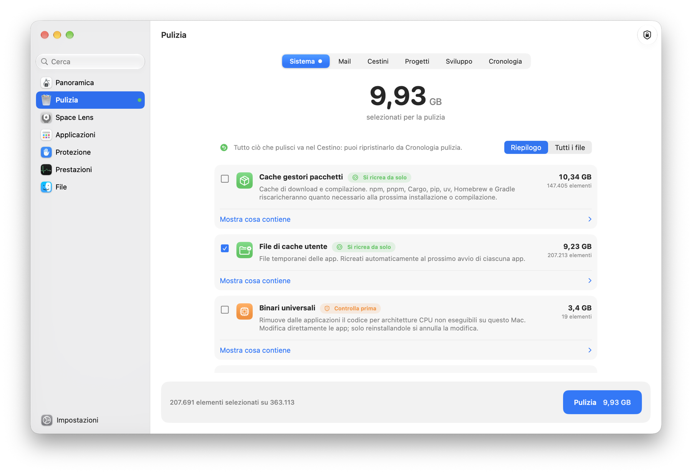
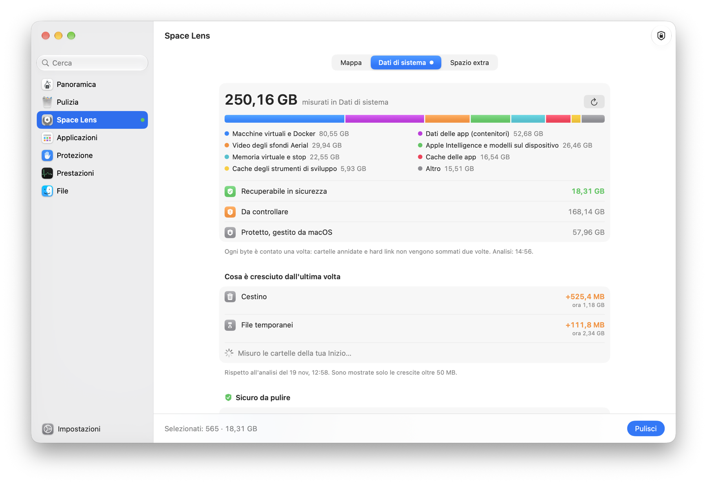
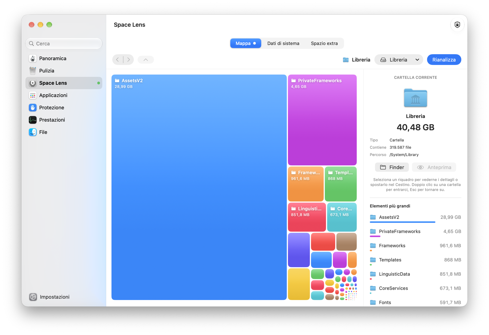
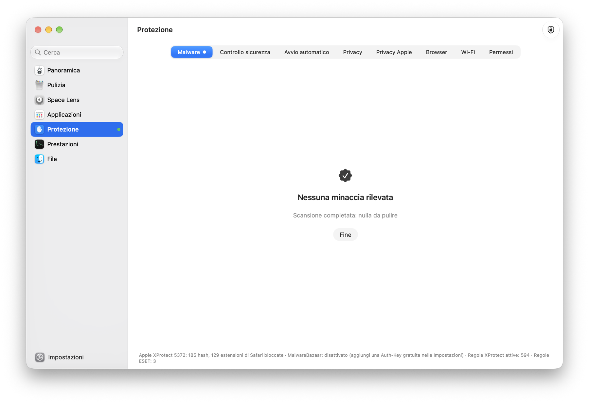
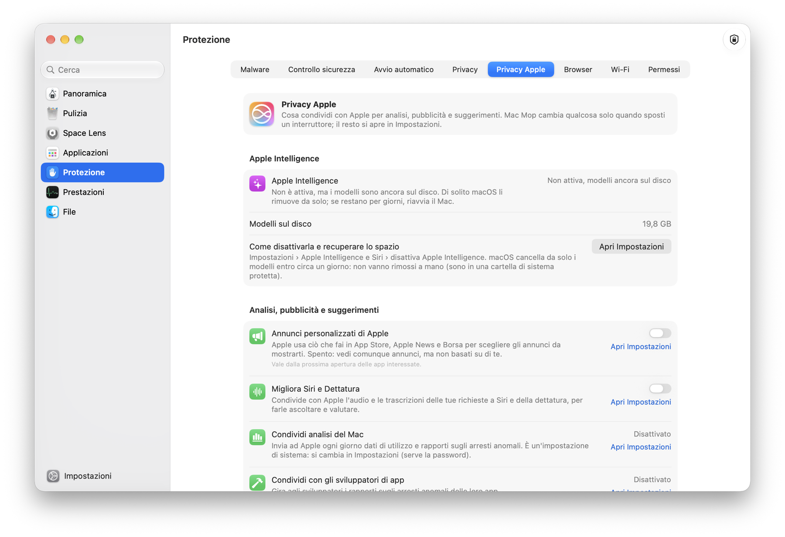

<p align="center">
  
</p>

<h1 align="center">Mac Mop</h1>

<p align="center">
  <strong>Un'app di pulizia per Mac che ti dice cos'è ogni file prima di toglierlo.</strong><br>
  Gratis, open source, nativa. Tutto ciò che pulisce finisce nel Cestino, quindi puoi riprenderlo.
</p>

<p align="center">
  <a href="https://github.com/maimorto/mac-mop/releases/latest"><strong>Scarica</strong></a> ·
  <a href="#cosa-fa">Cosa fa</a> ·
  <a href="#come-protegge-i-tuoi-file">Sicurezza</a> ·
  <a href="#privacy">Privacy</a> ·
  <a href="#cosa-non-fa">Limiti</a> ·
  <a href="README.md">English</a>
</p>

<p align="center">
  <a href="https://github.com/maimorto/mac-mop/releases/latest"></a>
  <a href="https://github.com/maimorto/mac-mop/releases"></a>
  
  
  <a href="LICENSE"></a>
</p>

<p align="center">
  
</p>

Molte app di pulizia mostrano un numero e un grande pulsante. Mac Mop mostra lo stesso numero e poi dice cosa c'è dietro: cos'è ogni gruppo di file, se macOS lo ricrea da solo e cosa cambia se lo togli. Tutto ciò che contiene dati tuoi parte deselezionato.

## Installazione

1. Scarica `MacMop-<versione>.dmg` dall'[ultima release](https://github.com/maimorto/mac-mop/releases/latest).
2. Aprilo e trascina Mac Mop in Applicazioni.
3. Apri Mac Mop. Non è ancora notarizzata da Apple, quindi la prima volta macOS la blocca: vai in Impostazioni di Sistema › Privacy e sicurezza, scorri in basso e fai clic su **Apri comunque**.

Richiede macOS 14 Sonoma o successivo su Apple silicon (M1 o successivi). Dà il meglio su macOS 26 Tahoe e successivi. La versione per Mac Intel non è ancora disponibile.

> [!CAUTION]
> Mac Mop è pubblicata solo in questo repository. È gratuita. Un sito che la vende, o che ti chiede di incollare un comando nel Terminale per averla, non è mio.

## Cosa fa

<table>
<tr>
<td width="50%"></td>
<td width="50%"></td>
</tr>
<tr>
<td><strong>Apre i "Dati di sistema".</strong> Ogni parte è misurata sul tuo Mac e segnata come sicura, da controllare o protetta da macOS. Ogni byte è contato una volta sola, e la scansione successiva mostra cosa è cresciuto.</td>
<td><strong>Mostra dov'è finito il disco.</strong> Una mappa in diretta di qualsiasi cartella, più file grandi e vecchi, duplicati, snapshot di Time Machine e altro spazio che macOS nasconde.</td>
</tr>
<tr>
<td width="50%"></td>
<td width="50%"></td>
</tr>
<tr>
<td><strong>Cerca malware per Mac.</strong> Usa tutte le regole XProtect di Apple già presenti sul tuo Mac (oggi 594), non solo gli hash dei file. Controlla anche cosa parte all'avvio e la cronologia del Terminale, e ti avvisa quando negli appunti c'è un comando da non incollare.</td>
<td><strong>Ti dà gli interruttori della privacy.</strong> Cosa condividi con Apple per pubblicità e analisi, in una pagina. Cache e cronologia di Safari, Chrome, Brave, Edge, Arc e Firefox, senza toccare password, cookie o estensioni wallet.</td>
</tr>
</table>

E il resto del lavoro:

- **Pulizia.** File di sistema inutili, cache delle app, log, vecchi installer, allegati di Mail, cache di Xcode e degli strumenti di sviluppo, cartelle di build dei progetti.
- **App.** Disinstalla un'app con ciò che ha lasciato in giro, e vedi perché ogni file le appartiene. Trova le app che non apri più. Rimuove i file sparsi dagli installer `.pkg`.
- **Prestazioni.** Elementi di login e processi in background (ciò che disattivi si può riattivare), manutenzione sicura, porte di rete aperte.
- **Controllo sicurezza.** FileVault, Gatekeeper, firewall e System Integrity Protection, con i passaggi per sistemare ciò che è spento.
- **Barra dei menu.** CPU, memoria, batteria e rete, ognuna come elemento a sé.
- **Salute del Mac.** Un punteggio su 100 e le due cose che lo alzerebbero di più.

## Come protegge i tuoi file

- **Quasi tutto si può riprendere.** I file puliti vanno nel Cestino. Cronologia pulizia li rimette dov'erano.
- **I tuoi dati partono deselezionati.** Ogni categoria ha un'etichetta: *Si ricrea da solo*, *Sicuro* o *Controlla prima*. Solo le prime due sono selezionate in automatico.
- **Puoi fare una prova.** *Prova senza pulire* esegue tutta la pulizia e mostra cosa verrebbe spostato, senza spostarlo.
- **Ricontrolla all'ultimo momento.** Un attimo prima di spostare un file, Mac Mop lo verifica di nuovo con le sue regole, nel caso sia cambiato qualcosa dopo la scansione.
- **Alcuni posti sono intoccabili.** Password, cookie, dati dei wallet e file protetti da macOS vengono mostrati, mai selezionati.

## Privacy

Niente analisi, niente account, niente pubblicità. I tuoi file non lasciano mai il Mac. Queste sono tutte le richieste di rete che Mac Mop può fare:

- **Pagina Aggiornamenti delle app, quando la avvii:** per ogni app installata che dichiara un feed di aggiornamento Sparkle, legge quel feed (lo stesso indirizzo che controllerebbe l'app stessa) per sapere se c'è una versione nuova.
- **MalwareBazaar, solo se aggiungi la tua chiave gratuita di abuse.ch** in Impostazioni: scarica l'elenco di hash. Senza chiave non contatta mai abuse.ch.
- **Barra dei menu › pannello Rete, solo mentre è aperto:** apre una connessione TCP verso `1.1.1.1:443` per misurare la latenza. Non invia nulla.

In questa versione Mac Mop non controlla da solo se esistono aggiornamenti: segui le release del repository per saperlo.

L'avviso sugli appunti legge il testo copiato sul tuo Mac per riconoscere gli attacchi "incolla questo nel Terminale": non viene mai salvato, registrato o inviato.

`scripts/check-network-surface.py` fa fallire la build se l'app acquisisce una chiamata di rete che non è in questo elenco.

## Cosa non fa

- **Non blocca il malware prima che parta.** Per farlo serve un permesso che Apple concede ai produttori di software di sicurezza. Mac Mop fa la scansione quando la chiedi e una volta a settimana, sorveglia alcune cartelle e ti dice cosa ha trovato.
- **Non è ancora notarizzata.** Da qui il passaggio in più alla prima apertura. In alternativa puoi leggere il codice e compilarla da te.
- **Non velocizza un Mac che sta bene.** Libera spazio e mostra cosa gira in background. Non "libera memoria", perché non serve a niente.

## Lingue

English, Italiano, Deutsch, Español, Português (Brasil), Français, 日本語, 한국어, Русский, Türkçe, فارسی, 简体中文, 繁體中文. L'app segue la lingua del Mac, oppure quella che scegli in Impostazioni.

## Compilare dal codice

```bash
git clone https://github.com/maimorto/mac-mop.git
cd mac-mop
./scripts/build-dmg.sh --app-only
open ".build/dmg/Mac Mop.app"
```

Serve Xcode 26 oppure i Command Line Tools. In [CONTRIBUTING.md](CONTRIBUTING.md) trovi i test e come si traducono i testi.

## Contribuire

Segnalazioni e pull request sono benvenute. Un'etichetta sbagliata su una categoria ("Sicuro" su qualcosa che non lo è) è il bug più utile che puoi segnalare: [apri una issue](https://github.com/maimorto/mac-mop/issues/new/choose) indicando il percorso.

## Licenza

BSD 3-Clause, vedi [LICENSE](LICENSE). Il codice e i dati ripresi da altri progetti open source sono elencati in [THIRD_PARTY_NOTICES.md](THIRD_PARTY_NOTICES.md).
