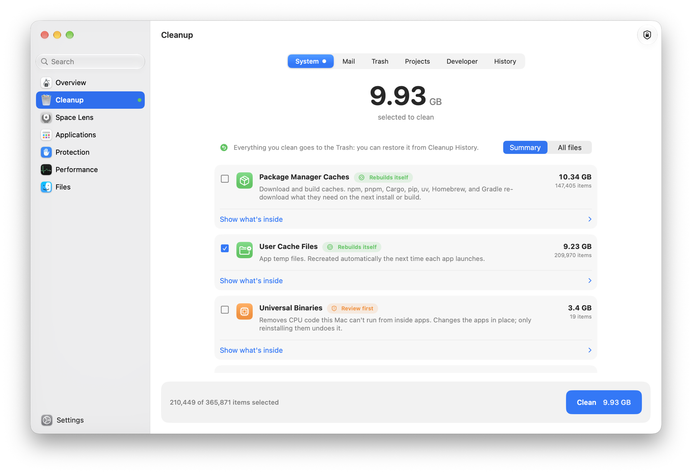
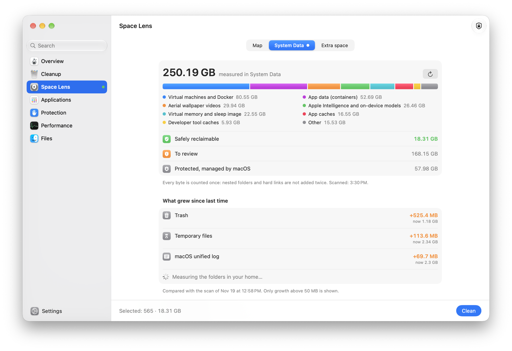
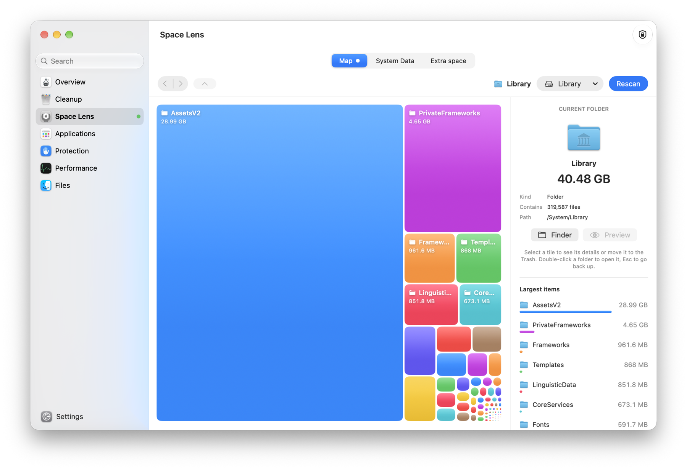
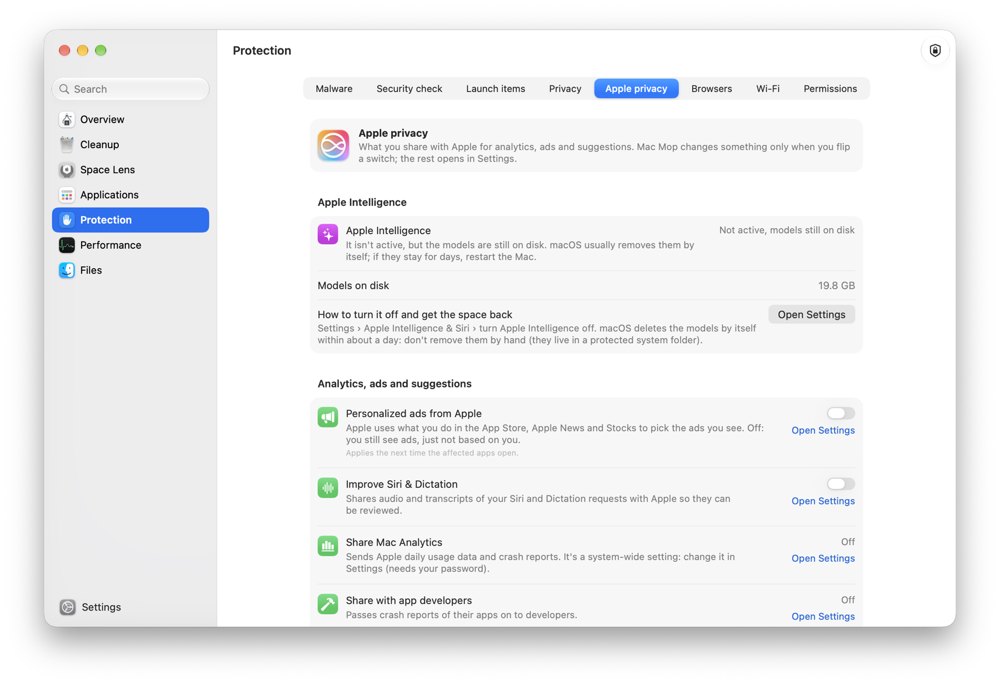

<p align="center">
  
</p>

<h1 align="center">Mac Mop</h1>

<p align="center">
  <strong>A Mac cleaner that tells you what every file is before you remove it.</strong><br>
  Free, open source, native. Everything it cleans goes to the Trash, so you can take it back.
</p>

<p align="center">
  <a href="https://github.com/maimorto/mac-mop/releases/latest"><strong>Download</strong></a> ·
  <a href="#what-it-does">What it does</a> ·
  <a href="#how-it-keeps-your-files-safe">Safety</a> ·
  <a href="#privacy">Privacy</a> ·
  <a href="#what-it-doesnt-do">Limits</a> ·
  <a href="README.it.md">Italiano</a>
</p>

<p align="center">
  <a href="https://github.com/maimorto/mac-mop/releases/latest"></a>
  <a href="https://github.com/maimorto/mac-mop/releases"></a>
  
  
  <a href="LICENSE"></a>
</p>

<p align="center">
  
</p>

Most cleaners show a number and a big button. Mac Mop shows the same number, then says what is behind it: what each group of files is, whether macOS makes it again on its own, and what changes if it goes. Anything that holds your own data starts unchecked.

## Install

1. Download `MacMop-<version>.dmg` from the [latest release](https://github.com/maimorto/mac-mop/releases/latest).
2. Open it and drag Mac Mop into Applications.
3. Open Mac Mop. It is not notarized by Apple yet, so the first time macOS blocks it: go to System Settings › Privacy & Security, scroll down and click **Open Anyway**.

Needs macOS 14 Sonoma or later on Apple silicon (M1 or newer). It looks best on macOS 26 Tahoe and later. An Intel build is not available yet: see [Contributing](#contributing).

> [!CAUTION]
> Mac Mop is published only in this repository. It is free. A site that sells it, or that asks you to paste a command into Terminal to get it, is not mine.

## What it does

<table>
<tr>
<td width="50%"></td>
<td width="50%"></td>
</tr>
<tr>
<td><strong>Opens "System Data".</strong> Every part is measured on your Mac and marked safe, to review, or protected by macOS. Each byte is counted once, and the next scan shows what grew.</td>
<td><strong>Shows where the disk went.</strong> A live map of any folder, plus large and old files, duplicates, and Time Machine snapshots and other space macOS hides.</td>
</tr>
<tr>
<td width="50%"></td>
<td width="50%"></td>
</tr>
<tr>
<td><strong>Checks for Mac malware.</strong> It runs all of Apple's XProtect rules already on your Mac (594 today), not only the file hashes. It also checks what starts at login, your shell history for paste-and-run attacks, and warns when the clipboard holds a command you should not paste.</td>
<td><strong>Gives you the privacy switches.</strong> What you share with Apple for ads and analytics, in one page. Browser caches and history for Safari, Chrome, Brave, Edge, Arc and Firefox, without touching passwords, cookies or wallet extensions.</td>
</tr>
</table>

And the rest of the job:

- **Cleanup.** System junk, app caches, logs, old installers, mail attachments, Xcode and developer caches, project build folders.
- **Apps.** Uninstall an app with what it left behind, and see why each file belongs to it. Find apps you no longer open. Remove files that `.pkg` installers scattered around.
- **Performance.** Login items and background agents (anything you switch off can be switched back on), safe maintenance tasks, open network ports.
- **Security check.** FileVault, Gatekeeper, firewall and System Integrity Protection, with the steps to fix what is off.
- **Menu bar.** CPU, memory, battery and network, each as its own small item.
- **Mac health.** One score out of 100, and the two things that would raise it most.

## How it keeps your files safe

- **Almost everything can come back.** Cleaned files go to the Trash. Cleanup History puts them back where they were.
- **Your data starts unchecked.** Each category has a label: *Rebuilds itself*, *Safe*, or *Review first*. Only the first two are selected for you.
- **You can rehearse.** *Dry run* goes through the whole cleanup and shows what would move, without moving it.
- **Checked again at the last moment.** Right before a file moves, Mac Mop checks it against its rules once more, in case something changed since the scan.
- **Some places are off limits.** Passwords, cookies, wallet data and files macOS protects are shown, never selected.

## Privacy

No analytics, no account, no ads. Your files never leave your Mac. This is every network request Mac Mop can make:

- **App updates page, when you run it:** for each installed app that declares a Sparkle update feed, it reads that feed (the same URL the app itself would check) to see if a newer version exists.
- **MalwareBazaar, only if you add your own free abuse.ch key** in Settings: it downloads the hash list. Without a key, it never contacts abuse.ch.
- **Menu bar › Network panel, only while it is open:** it opens a TCP connection to `1.1.1.1:443` to measure latency. Nothing is sent over it.

Mac Mop does not check for its own updates in this version: watch the repository's releases to hear about new ones.

The clipboard warning reads copied text on your Mac to spot "paste this into Terminal" attacks; it is never stored, logged or sent.

`scripts/check-network-surface.py` fails the build if the app gains a network call that is not on this list.

## What it doesn't do

- **It doesn't block malware before it runs.** That needs an entitlement Apple grants to security vendors. Mac Mop scans on demand and once a week, watches a few folders, and tells you what it found.
- **It isn't notarized yet.** Hence the extra step on first open. You can read the code and build it yourself instead.
- **It won't speed up a healthy Mac.** It frees disk space and shows what runs in the background. It doesn't "boost" memory, because that does nothing useful.

## Languages

English, Italiano, Deutsch, Español, Português (Brasil), Français, 日本語, 한국어, Русский, Türkçe, فارسی, 简体中文, 繁體中文. The app follows your Mac's language, or the one you pick in Settings.

## Build from source

```bash
git clone https://github.com/maimorto/mac-mop.git
cd mac-mop
./scripts/build-dmg.sh --app-only
open ".build/dmg/Mac Mop.app"
```

Needs Xcode 26 or the Command Line Tools. See [CONTRIBUTING.md](CONTRIBUTING.md) for tests and how strings are translated.

## Contributing

Bug reports and pull requests are welcome. A wrong label on a category ("Safe" on something that isn't) is the most useful bug you can report: please [open an issue](https://github.com/maimorto/mac-mop/issues/new/choose) with the path.

## License

BSD 3-Clause, see [LICENSE](LICENSE). Code and data reused from other open-source projects are listed in [THIRD_PARTY_NOTICES.md](THIRD_PARTY_NOTICES.md).
