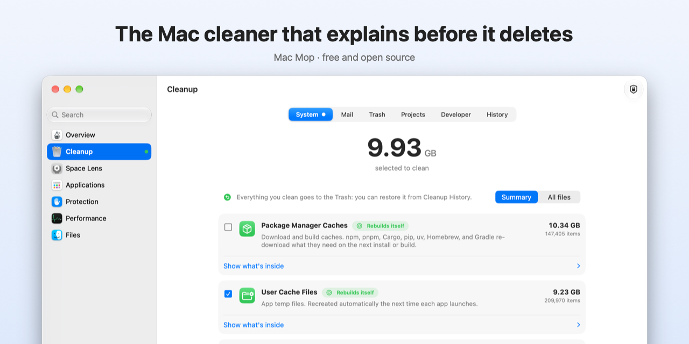
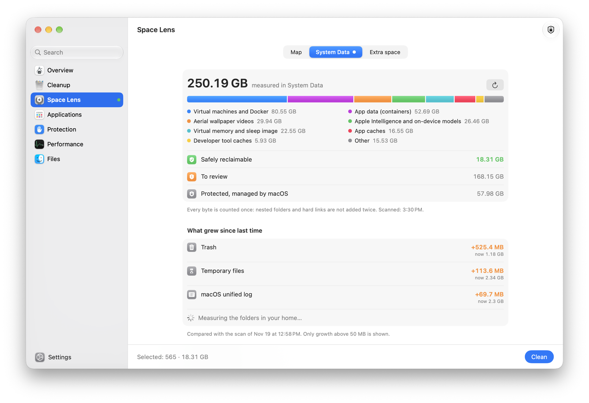
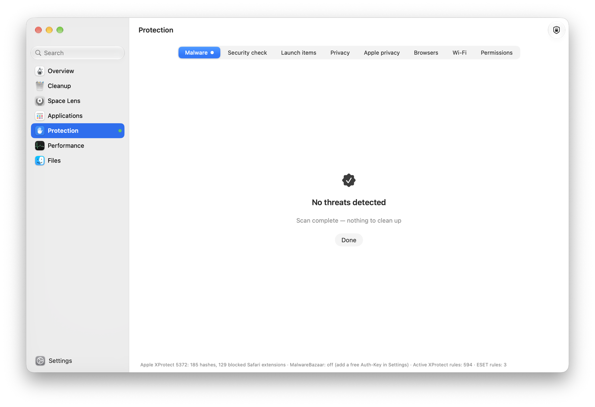
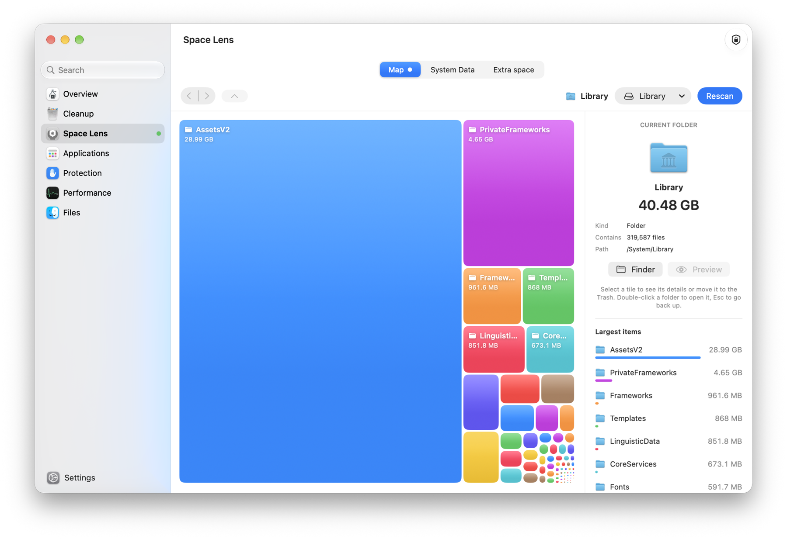
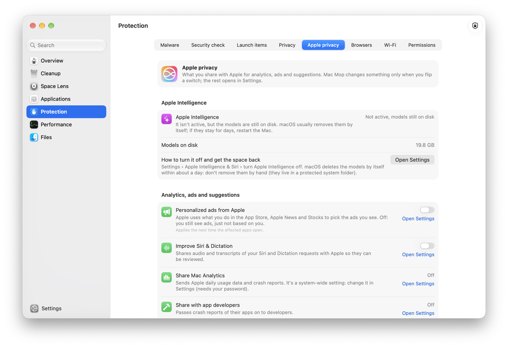

<p align="center">
  
</p>

<h1 align="center">Mac Mop 0.0.1</h1>

<p align="center"><strong>The Mac cleaner that explains before it deletes.</strong><br>
Free · open source (BSD-3) · native SwiftUI · 13 languages · no account, no analytics</p>

<p align="center">
  
</p>

My Mac had 7% free disk. System Settings said **"System Data: 250 GB"** and nothing else.

So I measured it. 80 GB of virtual machine and Docker disks. 30 GB of aerial wallpaper videos. 26 GB of Apple Intelligence models on a Mac where Apple Intelligence was switched off. The rest was app containers, caches and the sleep image.

I didn't want a cleaner to *guess* which of those were safe to remove. So I built one that has to explain itself first: what a group of files is, whether macOS recreates it, and what changes if it goes. Everything it removes goes to the Trash, and a history page puts it back.

This is the first public release. It's early, it has rough edges, and I'd rather you find them now.

---

## Download

**[`MacMop-0.0.1.dmg`](#assets)** (below, in Assets) · macOS 14 or later · Apple silicon (M1 and newer)

1. Open the disk image. Either drag **Mac Mop** to Applications, or open it from the disk image and press **Install in Applications**.
2. Mac Mop is not notarized yet, so macOS blocks the first launch. Go to **System Settings › Privacy & Security**, scroll down and click **Open Anyway**.
3. Grant **Full Disk Access** when asked, so the scans can see everything.

Check that your download is this build:

```
shasum -a 256 MacMop-0.0.1.dmg
fd4f3459b224d1f490b74b712ffcca7bc1bf73cbf44bc036e2aaf7f952723974
```

> [!CAUTION]
> Mac Mop is published only here and it's free. A site that sells it, or tells you to paste a command into Terminal to install it, is not this project.

---

## What's inside

### A cleanup that has to explain itself

Every category comes with a plain sentence and one of three labels: **Rebuilds itself**, **Safe** or **Review first**. Anything that holds your own data starts unchecked.

- **Trash only.** Nothing is deleted outright except when you empty the Trash Bins yourself. **Cleanup History** restores any cleanup to its original place, and right after a cleanup there's an **Undo** (⌘Z).
- **Dry run.** The first cleanup, and every cleanup if you want, shows exactly what would move, per category, and what the safety rules would skip, before anything moves.
- **Checked again at the last moment.** Right before each file goes, Mac Mop checks it once more: still there? Same file as when scanned (inode, size, modification date)? Not an app that's running? Not wallet, browser, Keychain or Notes data? Changed items are skipped and counted on the done screen.
- **Off limits by design.** Passwords, cookies, browser profiles, wallet apps and wallet extensions (MetaMask, Phantom, Solflare and others), Keychains. They can be shown, never selected.

### "System Data", opened up



28 categories, each measured on your Mac and marked **safe**, **to review** or **protected by macOS**, with one line on what it is and what Mac Mop can do about it: move it to the Trash, show you the steps, or nothing.

Every byte is counted once: nested folders aren't added twice, hard links count once, and the walk never follows symlinks or crosses into another volume. A full scan of 818k items takes about 5 seconds.

Each scan is kept, so the next one shows **what grew**, both by category and by folder in your home.

### Malware checks built for 2026, not 2016

Adware is mostly gone. Infostealers (AMOS, Odyssey, MacSync and new ones written in Go) are what hit Macs now. They usually don't arrive as a file you download: a fake web page asks you to paste a command into Terminal ("ClickFix"). Hash lists don't catch that.



- **All of Apple's XProtect rules, not just the hashes.** Every Mac ships `XProtect.yara` and `XPScripts.yr` in plain text. Mac Mop includes a YARA engine written in Swift that evaluates them on demand. On macOS 27.2 that's **594 of 594 rules**: text, hex with jumps and wildcards, regex, `for … of`, rule references. A rule using a feature the engine doesn't support is skipped, never loosened. Tested with **0 hits on about 5,500 clean files**. ESET's open macOS rules (BSD-2) are included too.
- **Behaviour rules for how stealers actually work.** These rules look for:
  - remote scripts piped into a shell, and base64 payloads decoded into `sh` or `osascript`;
  - fake password dialogs (`display dialog … with hidden answer`) and password checks with `dscl . -authonly`;
  - data zipped into `/tmp` and then uploaded;
  - Keychain dumps;
  - wallet and browser credential stores being archived.

  Obfuscation is normalised first. Trusted installers (Homebrew, rustup, nvm and friends) are recognised, so developer machines don't light up.
- **Your Terminal history.** If a past command matches one of those patterns, Mac Mop says so, says when it ran, and tells you what to do next: change passwords from another device, move crypto to a new wallet, log out of every session.
- **Clipboard guard.** Copy a ClickFix command and a warning appears before you paste it. The text is read on your Mac and never stored or sent.
- **Persistence, all of it.** Launch items across 26 mechanisms: launch agents and daemons, login and background items, cron, periodic, PAM, sudoers.d, authorization and Directory Services plug-ins, DYLD injection, shell startup files and more. Each comes with who signed it and whether it's notarized. Anything you switch off stays in the list with **Re-enable**.
- **Also in this release:**
  - **Quarantine:** an optional, restorable alternative to the Trash, with execute bits stripped.
  - **Weekly scan:** a Balanced scan that runs on its own.
  - **XProtect activity:** what Apple's own scanner did recently, read from the system log.
  - **Family names:** XProtect codenames translated into the families people know.

A Deep scan of a home folder with 5.1 million files in Downloads takes about 6 seconds. It used to never finish.

### Where the disk went, and what's hiding

<table>
<tr>
<td width="50%"></td>
<td width="50%"></td>
</tr>
<tr>
<td><strong>Space Lens.</strong> A treemap that fills in live while it scans. The walker uses <code>getattrlistbulk</code>, counts hard links once and skips firmlinked duplicates, so on a 19 GB folder it agrees with <code>du</code> to within 0.1%. Back and forward work like Finder.</td>
<td><strong>Apple privacy.</strong> What you share with Apple for ads, analytics and Siri, each read from its real setting. Mac Mop only changes something when you flip a switch. The Apple Intelligence section shows how much disk its models take and how to get that space back.</td>
</tr>
</table>

- **Uninstaller** that shows why each leftover belongs to the app (preferences domain, container, app group from its signature, launch item, bundle id or team id) and how sure it is. Uncertain files start unchecked. It also shows a **trust panel** for every app: who signed it, whether it's notarized, where it was downloaded from, and which permissions it asks for. You can remove several apps at once, or use **Uninstall with Mac Mop** from Finder's Services menu.
- **Installed packages:** removes the files `.pkg` installers scattered around, which normal uninstallers never see. Apple packages and shared folders are protected.
- **Also covered:** large and old files, duplicates (removed, or turned into APFS clones that take no extra space), Time Machine snapshots, installers, Docker images, mail attachments, developer and project caches.

### The rest

- **Security check:** 24 settings (FileVault, firewall and stealth mode, Gatekeeper, SIP, updates, screen lock, sharing services, AirDrop, Time Machine…), each with why it matters, numbered steps and a button to the exact System Settings pane.
- **Menu bar:**
  - RAM, battery, network and CPU as their own compact items, with free disk next to the mop;
  - panels for CPU, GPU, memory, battery, network and disk;
  - a home panel with one-click actions.
- **Network ports:** what is listening, and whether other devices can reach it.
- **Feels like a Mac app:**
  - Back and Forward everywhere (⌘[ ⌘]);
  - ⌘F search across sections, settings and result lists;
  - context menus with Show in Finder, Quick Look and Copy Path;
  - Esc closes what it should;
  - native Tahoe look with system icons.

---

## Under the hood

| | |
|---|---|
| Stack | Swift 6, SwiftUI, Swift Package Manager. Three targets: `MacCleaner` (app), `MacCleanerMenu` (menu bar helper), `MacCleanerKit` (pure logic, tested) |
| Build | Builds with only the Command Line Tools; no Xcode project, no third-party build tooling |
| Tests | 301 Swift Testing tests. `MC_SWIFT_TESTING_ONLY=1 swift test` runs them on a machine without Xcode |
| Network guard | `scripts/check-network-surface.py` fails the build if the app gains a network call that isn't on the allowlist |
| Idle cost | 1–3% CPU with the app open on the Overview |
| Translations | Every string in 13 languages. Strings are written once in code; `scripts/l10n-extract.py` lists what's missing per language |
| Disk image | The DMG window is written without driving Finder (own `.DS_Store` writer). The app offers to install itself when opened from the disk image |

### Every network request Mac Mop can make

1. **App updates page, when you run it:** reads the Sparkle update feed each installed app declares.
2. **MalwareBazaar:** only if you add your own free abuse.ch key.
3. **Menu bar › Network panel:** a TCP connection to `1.1.1.1:443`, only while that panel is open, to measure latency.

That's the whole list. Mac Mop doesn't check for its own updates in this version: **watch this repository → Releases only** to hear about the next one.

---

## Honest limits

- **Not notarized.** Hence the extra click. The code is all here if you'd rather build it.
- **Apple silicon only for now.** The Intel build fails to link one dependency with the Command Line Tools alone.
- **No real-time blocking.** Stopping a program before it runs needs Apple's Endpoint Security entitlement. Mac Mop scans, watches a few folders and warns you.
- **No "RAM booster", no "speed up your Mac".** Freeing memory does nothing useful, and this app won't pretend otherwise.
- **Translations were machine-assisted.** If your language reads oddly, that's a five-minute pull request.

---

## Make it better

If Mac Mop saved you some space, **a star helps the next person with a full disk find it.**

If you want to build on it, these are real, scoped and waiting:

| Area | What's needed | Size |
|---|---|---|
| Labels | Find a category marked *Safe* that isn't. Open an issue with the path. This is the most valuable report | small |
| Translations | Review your language's strings in `Sources/MacCleanerKit/Strings/` | small |
| Intel | Make the x86_64 slice link with the Command Line Tools (GRDB pulls in `swiftCompatibility56`) | medium |
| Space Lens | A filter for the treemap (by type, age or size) | medium |
| Duplicates | "Back to results" after removing, by rebuilding the groups | medium |
| Detection | New behaviour rules for stealers as they appear. Each needs tests with real-world command lines | medium |
| Real time | An optional privileged helper around `eslogger` for live process and file events | large |

Fork it, open a draft PR early, and say what you're attempting in the issue so nobody duplicates work. `CONTRIBUTING.md` covers the build, the tests and how strings are translated.

---

BSD 3-Clause. Code, data and rules reused from other open-source projects (MacSpace, MacPersistenceChecker, ESET malware-ioc) are listed with their licences in [`THIRD_PARTY_NOTICES.md`](https://github.com/maimorto/mac-mop/blob/main/THIRD_PARTY_NOTICES.md).
